<p align="center">
  
</p>

<p align="center">
  <strong>Your new best friend when it comes to prompting in ComfyUI</strong><br>
  Prompt editing, wildcard libraries, Fields workspaces, local LoRA browsing, generation comparison, batch expansion, and model-aware weighting for ComfyUI.
</p>

<p align="center">
  <a href="https://z3rofeels.github.io/comfyui-promptpalette/">
  
  
  
  
</p>

<p align="center">
  
</p>

> [!TIP]
> **Start with Prompt Palette.** The Combinatorial and Weight Controller nodes are specialized companions—not requirements. Add them only when your workflow needs batch expansion or dedicated prompt-weight routing.

<p align="center">
  <a href="#whats-new">What's New in 2.1.0</a> ·
  <a href="#choose-your-node">Suite</a> ·
  <a href="#installation">Installation</a> ·
  <a href="#prompt-palette">Editor</a> ·
  <a href="#fields-workspace">Fields</a> ·
  <a href="#lorapal">LoraPal</a> ·
  <a href="#keep-and-evolve">Keep &amp; Evolve</a> ·
  <a href="#booru-autocomplete">Autocomplete</a> ·
  <a href="#main-sidebar">Sidebar &amp; Styles</a> ·
  <a href="#combinatorial">Combinatorial</a> ·
  <a href="#weight-controller">Weight Controller</a> ·
  <a href="#wildcard-syntax">Syntax</a> ·
  <a href="#troubleshooting">Reference</a>
</p>

<p align="center"></p>

<a id="whats-new"></a>
## What's New in 2.1.0

Prompt Palette **2.1.0** brings together **Keep & Evolve**, **LoraPal Model Info**, **opt-in Style Studio & Style Autocomplete**, **expanded Starter Packs**, and a cleaner, faster virtualized UI across both ComfyUI Nodes 1.x and 2.x.

| Area | Highlights |
|---|---|
| **Style Studio & Autocomplete** *(opt-in)* | Dedicated **Krea 2 & MOSS-Image** sidecar with **94** curated entries across **12** facets and **8** curated mixes, `{%a|b}` Mix Composer, MOSS Caption / Ordered Tags / Spatial JSON dialects, quoted typography helper, conflict/buzzword lint, and live style autocomplete (`style:`, `cam:`, `lens:`, `light:`, `krea2:`, `moss:`). |
| **Expanded Starter Packs (`v2.2.0`)** | **12** model-ready packs—including expanded **Universal (54)**, **KREA 2 (50)**, and **MOSS-Image (30)** alongside **MiniMax H3, Qwen Image, Z-Image Turbo, LTX-2.3, Anima, Illustrious, Pony, SDXL,** and **Prompt Palette Syntax**—with tag/facet search and an optional Style Studio bridge. |
| **Keep & Evolve & Inspector** | **Recent Generations** in the sidebar with **Gallery, Masonry, Filmstrip, and List** views, a Civitai-style pop-out **Generation Inspector** (`Raw Input` vs `Final Resolved`, wildcard selections, color-matched LoRAs, parameter tiles, collapsible `Workflow & Nodes`), **Keeper** pinning, **4-way A/B wipe** comparison, and **Promote / Refine** (`Commit / Cancel`). |
| **LoraPal & LoRAs Sidebar Tab** | Unified local LoRA browsing in both the floating sidecar and the main sidebar **LoRAs** tab, pop-out **Model Info** flyout with multi-preview image/video stepping, `1.0` base-strength init, trailing `# --- LoRAs ---` prompt docking, **Saved LoRA sets**, and **LoRA Audition Lab**. |
| **Fields, Ports, Drafts & Toolbar** | Per-field `In: <Field>` / `Out: <Field>` sockets with pre-run **Import / Disconnect**, **Jump to field**, **Field & title** accents, **Ports** search with up to **16 Saved port layouts**, named **A–D** quick drafts with overwrite preview, compact toolbar **Seed** pill, and an **Auto hide** bottom status bar. |

<details>
<summary><strong>Release history (2.0.5 – 2.0.9)</strong> — see <a href="CHANGELOG.md">CHANGELOG.md</a> for full notes</summary>

- **2.0.9 — Keep & Evolve:** Keeper reference pinning, 4-candidate A/B wipe comparison, Promote & Refine (`Commit / Cancel`), pop-out LoRA Model Info flyout, sidebar **LoRAs** tab, per-field IN/OUT sockets, named A–D drafts, Find & Replace previews, compact top-edge **Ports** with 16 saved layouts, toolbar **Seed** pill, and auto-hiding status bar.
- **2.0.8 — LoraPal & Flexible Workspaces:** Local LoraPal browser and Audition Lab, adjustable multi-column Fields, Tiles and Contact Sheet library views, A–D quick slots, Seed Lab, Anima 1.0 weighting mode, Settings search, and optional library intelligence.
- **2.0.7 — Visual Browsing & MOSS:** Shared wildcard thumbnails across Library, sidebar, and autocomplete; **MOSS-Image** starters and literal JSON preservation; **One field at a time** comparisons; 193 bundled style/artist references; `Ctrl/Cmd+Enter` run pass-through.
- **2.0.6 — Main Sidebar & Field Variation:** Main ComfyUI sidebar tabs (**Library, Explore, Syntax, Tools**), **59k+ Anima artist** search (`@artist`), `Vary / Lock / Follow` field modes, `[switch]` conditionals, and **Positive Antonyms**.
- **2.0.5 — Selective Variation & Booru Autocomplete:** Offline Danbooru + custom-word autocomplete, Adjustable Recipe Workspace, **Variation Lab**, customizable toolbar, image prompt import, **Choices & rules**, and **Prompt Inspector**.

</details>

<p align="center"></p>

<a id="choose-your-node"></a>
<p align="center">
  
</p>

<p align="center">
  
</p>

| Node | Best for | What it returns |
|---|---|---|
| **Prompt Palette** | Everyday prompt writing, wildcard browsing, Fields workspaces, LoRAs, previewing, and optional encoding | Resolved prompt text, optional positive/negative conditioning, model/CLIP passthrough, seed, variables, and wildcard metadata |
| **Prompt Palette (Combinatorial)** | Producing many deliberate prompt variations from one template | Lists of prompts, seeds, wildcard metadata, per-field outputs, and optional per-prompt conditioning/model/CLIP outputs |
| **Prompt Palette (Weight Controller)** | Applying and translating explicit `(phrase:weight)` instructions for different text backends | Backend-ready text, raw weight dictionary, compatibility text, optional conditioning, and model/CLIP passthrough |

All three nodes appear under the **PromptPalette** category and share autocomplete, shortcuts, and theme settings.

### Compact Ports & Saved Port Layouts

Open **Ports** on any Prompt Palette node to search by name or type, switch between **Show all**, **Recommended**, and **Hide unused**, pin the manager open, or save up to **16 Saved port layouts** per node (including per-field sockets). When **Ports** is closed, active inputs and outputs collapse into compact color-coded dots along the top edge—hover any dot to inspect its name, type, and connection state.

<p align="center">
  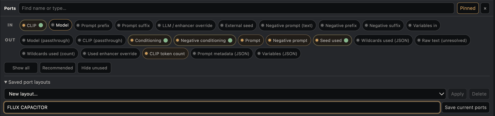
</p>

<p align="center"></p>

<a id="installation"></a>
<p align="center">
  
</p>

### Standard ComfyUI

Use **Python 3.10+** and a current ComfyUI build with the V3 custom-node API. The optional MOSS examples require **ComfyUI 0.42.1+** and the model files listed in the [MOSS guide](MOSS_PROMPTING.md). Prompt Palette contains node code and bundled reference data—no model weights or automatic downloads.

Search for **Prompt Palette** by **z3rofeels** in ComfyUI’s extension manager (Registry ID: `zf-prompt-palette`), or install manually:

```bash
cd ComfyUI/custom_nodes
git clone https://github.com/z3rofeels/comfyui-promptpalette.git
python -m pip install -r comfyui-promptpalette/requirements.txt
```

Use the Python environment that runs ComfyUI to install requirements. Restart ComfyUI, then search the node menu for **Prompt Palette**.

<details>
<summary><strong>Windows portable command</strong></summary>

Run this from your `ComfyUI_windows_portable` folder:

```bat
cd ComfyUI\custom_nodes
git clone https://github.com/z3rofeels/comfyui-promptpalette.git
..\..\python_embeded\python.exe -m pip install -r comfyui-promptpalette\requirements.txt
```

Restart the portable launcher after installation.
</details>

<details>
<summary><strong>Updating</strong></summary>

```bash
cd ComfyUI/custom_nodes/comfyui-promptpalette
git pull
python -m pip install -r requirements.txt
```

Restart ComfyUI and hard-refresh the browser after frontend updates.

> [!IMPORTANT]
> Before a manual update, back up your custom files and configuration. For a **v1 → v2 update**, use a clean extension folder, then restore your custom files. Keep only one active Prompt Palette installation.
</details>

### Wildcard library location

By default, Prompt Palette creates and scans `ComfyUI/wildcards/`, supporting nested `.txt`, `.yaml`, and `.yml` libraries. Choose a different folder in **Settings** on the machine running ComfyUI, or configure `wildcards_config.json` / a `wildcards:` entry in ComfyUI's `extra_model_paths.yaml`.

```text
ComfyUI/wildcards/
├── characters/
│   └── monsters.txt        → __characters/monsters__
├── lighting/
│   └── cinematic.txt       → __lighting/cinematic__
└── styles.yaml             → nested YAML keys become slash paths
```

<p align="center">
  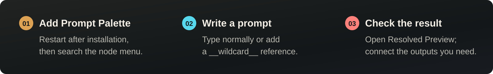
</p>

<p align="center"></p>

<a id="prompt-palette"></a>
<p align="center">
  
</p>

Prompt Palette replaces ComfyUI's plain text box with a wildcard-aware creative workspace while staying completely optional in wiring: leave every extra port off and it works like a clean resolving prompt node, or connect `CLIP` and `Model` when you want integrated LoRA loading and direct conditioning.

<p align="center">
  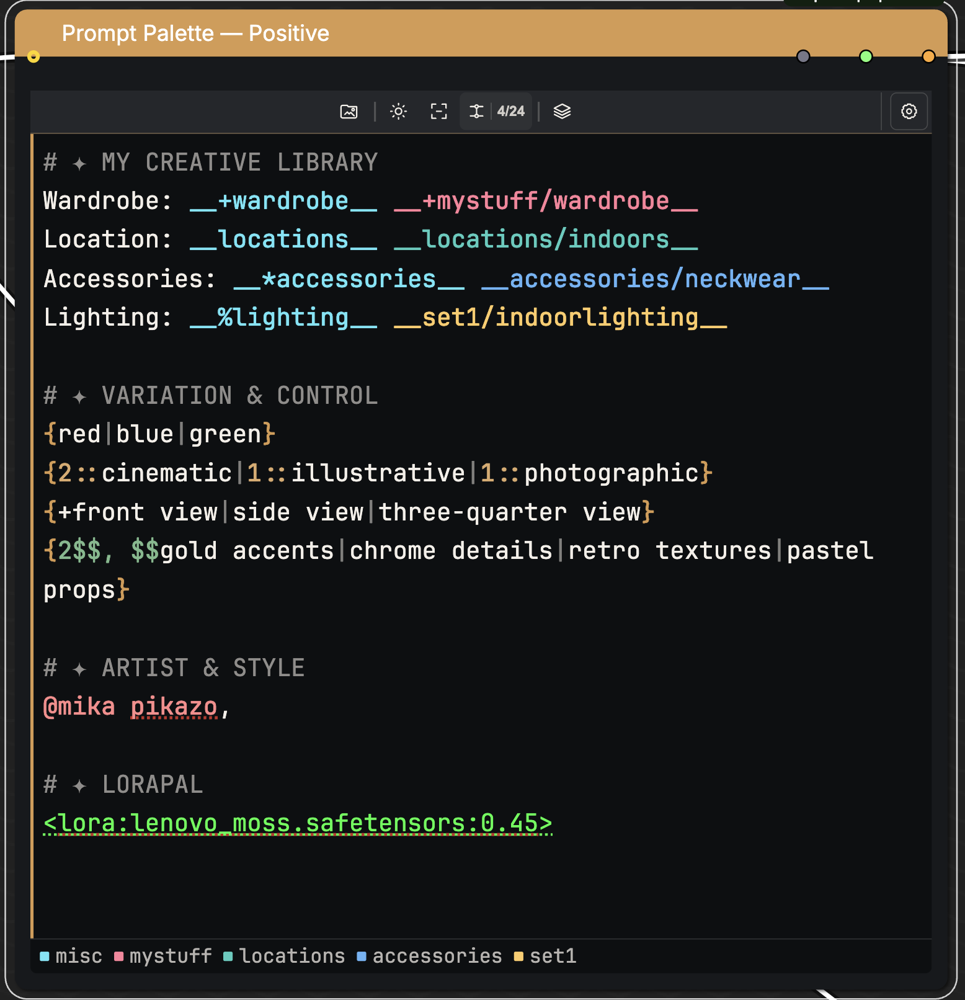
</p>

### The 30-second tour

1. **Write naturally.** `__wildcards__`, `{inline|choices}`, `@artists`, and `<lora:name:weight>` tags are color-coded directly in your prompt.
2. **Browse & insert.** Open **Library** on the node (or the ComfyUI sidebar) to search **My Library**, preview entries, or explore **Starter Packs**.
3. **Edit in place.** Open **Edit**—or double-click any `__wildcard__`—to create or edit `.txt` entries without leaving ComfyUI.
4. **Preview before queueing.** Use **Preview** to inspect the exact resolved text (**Manual**, **After pause**, or **Live** in Settings).
5. **Make it yours.** Open **Settings** for **Theme Studio**, workspace presets, toolbar layout, typography, wildcard paths, and optional Power Tools.

### Wildcard-first editing & Syntax Injector

- **Folder colors & legend** keep complex multi-part prompts readable at a glance.
- **Missing wildcard detection** marks broken references and lets you jump straight to them.
- **Hover preview** shows a wildcard file's contents without inserting it.
- **Double-click a token** to open that wildcard in the Edit drawer.
- **Right-click a token** to open the **Syntax Injector** and rewrite that exact occurrence (random, unseeded, sequential `+/-`, Cartesian `%`, weighted, joined ranges, variables, or conditionals).
- **Full undo & redo** covers typing, inserts, autocomplete, syntax transforms, and clearing.

<p align="center">
  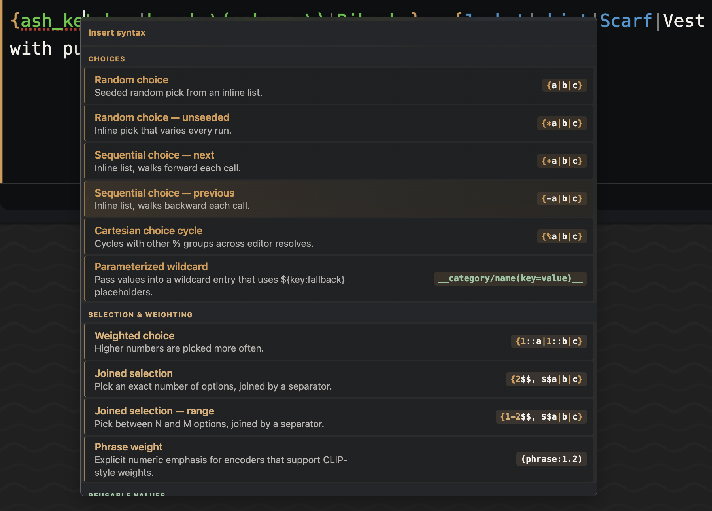
</p>

### Named Drafts A–D, Refine & Find & Replace

Switch between **four independent prompt drafts (`A–D`)** inside the same node—each preserving its own positive text, negative text, and Fields workspace. Right-click (or click the active letter) to **rename** a slot, preview its contents, or **Copy X into Y…** (`Alt/Option+1–4` switches; add `Shift` to review and copy). Need to iterate without risking other drafts? Click **Refine** on the toolbar for an in-node **Commit / Cancel** session.

Press `Ctrl/Cmd+F` for **Find** or `Ctrl+H` / `Cmd+Option+F` for **Replace**, with **Aa** case, **Word**, range-safe **In selection**, and an expandable **Preview replacements** drawer before changing text. `Ctrl/Cmd+Enter` passes straight through to queue ComfyUI normally.

<table>
  <tr>
    <td width="42%" align="center" valign="middle">
      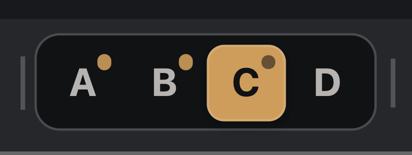<br>
      <sub><strong>Quick drafts A–D</strong> · rename, preview, and copy with diff review</sub>
    </td>
    <td width="58%" align="center" valign="middle">
      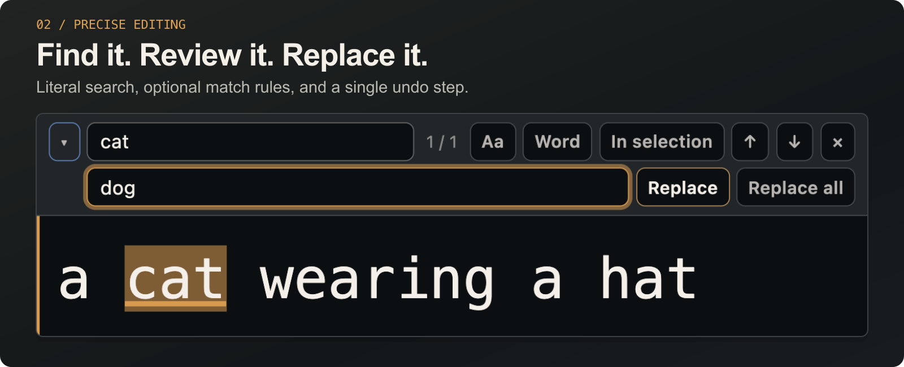<br>
      <sub><strong>Find &amp; Replace</strong> · match rules, in-selection scope, and replacement previews</sub>
    </td>
  </tr>
</table>

### Seed Controls, Seed Lab & Wheel of Fortune

Enable **Settings → Toolbar & layout → Toolbar modules → Seed controls** to add a compact **Seed** pill right on the toolbar showing your live seed and run behavior (`Fixed`, `Increment`, `Decrement`, `Randomize`). Click it for the floating Seed panel, or **Shift+Click** to jump straight into **Wheel of Fortune**. Open **Seed Lab** for recent seeds, pinned favorites, presets, and **Seed Fortune** archetypes.

<table>
  <tr>
    <td width="46%" align="center" valign="top">
      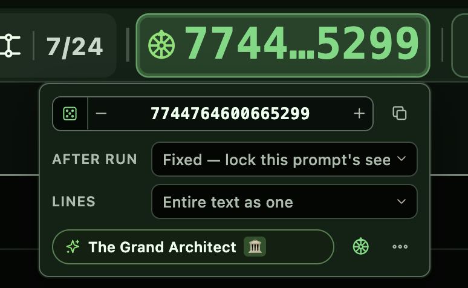<br>
      <sub><strong>Compact toolbar Seed pill</strong> · zero dedicated node row</sub>
    </td>
    <td width="54%" align="center" valign="top">
      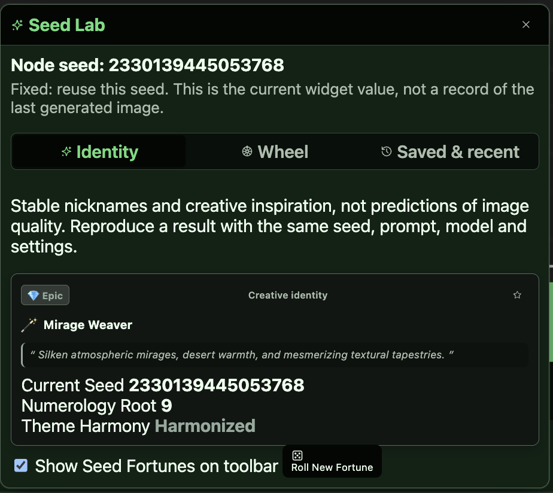<br>
      <sub><strong>Seed Lab</strong> · Identity archetypes, Wheel of Fortune, and saved seeds</sub>
    </td>
  </tr>
</table>

<details>
<summary><strong>Watch Seed Lab &amp; Wheel of Fortune in action</strong></summary>

<p align="center">
  
</p>

</details>

<p align="center"></p>

<a id="fields-workspace"></a>
### Fields Workspace

Enable **Adjustable Recipe Workspace** in **Settings → Power tools** to organize prompts into color-coded, reorderable fields—Subject, Wardrobe, Environment, Lighting, Camera, Negative, or any custom structure—while keeping a live compiled preview.

<table>
  <tr>
    <td width="60%" align="center" valign="top">
      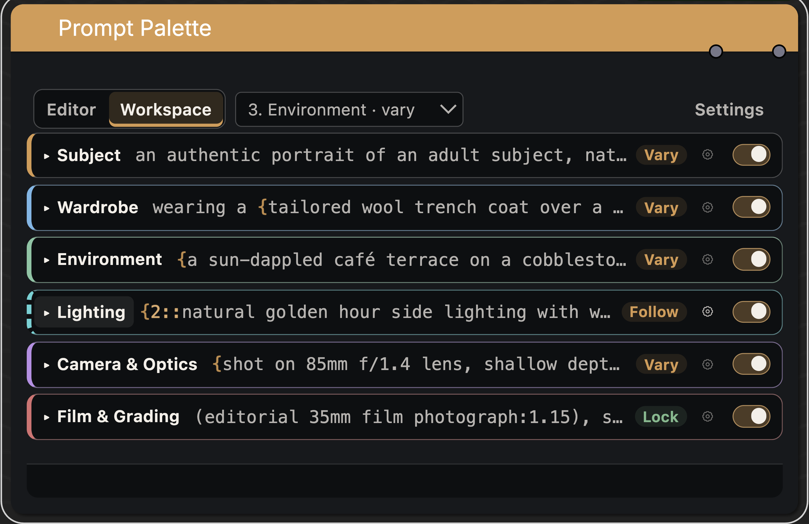<br>
      <sub><strong>Collapsed overview</strong> · Jump to field navigator, accent targets, and Vary/Follow/Lock badges</sub>
    </td>
    <td width="40%" align="center" valign="top">
      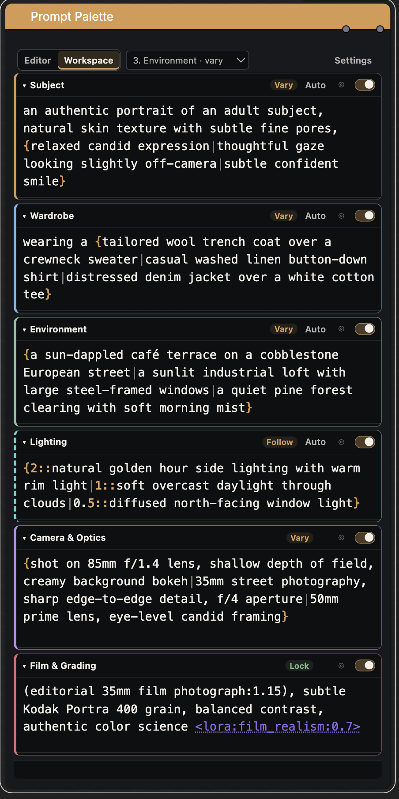<br>
      <sub><strong>Expanded editing</strong> · per-field choices, weights, and LoRAs</sub>
    </td>
  </tr>
</table>

| Field mode | Behavior during generation |
|---|---|
| **Vary** | Cycles through supplied choices each generation, even with a fixed seed (or use Shuffle / By seed / written syntax). |
| **Lock** | Captures the current resolved value and holds it across seed changes and workflow reloads without deleting your alternatives. |
| **Follow** | Holds its pick until a chosen source field changes, then resolves again. |
| **Default** | Evaluates the field's authored prompt syntax normally. |

- **Per-field `IN` and `OUT` sockets:** In **Field settings**, enable **Input text → Socket** (`In: <Field>`, inserted before or after widget text, with pre-run **Import** and **Disconnect** actions) and **Output text → Socket (STRING)** (`Out: <Field>`, exposing that field's resolved text for regional conditioning—and emitting a matching list on **Combinatorial**).
- **Grid layout & accents:** Choose **1, 2, 3, or Auto-fit** columns, drag field bottom grips with **8px** snapping (double-click to reset), and apply accents to **Field and title**, **Field only**, **Title only**, or **No accent**.
- **Starter Layouts, Presets & Snapshots:** Load starters for **FLUX · Natural language**, **Realistic photo**, **Video & Motion (Wan / Hunyuan)**, **Anime image**, **Portrait**, **Character sheet**, **Scene**, **Product render**, **Anima Structure**, and **Negative prompt set**—or save your own field presets and **Snapshots & variants**.

### Prompt Library, Recipes, Stash & Starter Packs

<table>
  <tr>
    <td width="33%" valign="top">
      <strong>Prompt Library</strong><br>
      Browse <em>My Library</em> in <strong>List, Gallery, Masonry, Tiles, Contact sheet,</strong> or <strong>Filmstrip</strong> views. Pin favorites, set custom PNG/JPEG thumbnails (up to 8 MB), and scale cards with <strong>Fit</strong> or <strong>Fill</strong>.
    </td>
    <td width="33%" valign="top">
      <strong>Palette Recipes &amp; Stash</strong><br>
      Save reusable multi-entry <strong>RECIPES</strong> right alongside normal wildcards, or park work-in-progress prompts inside <strong>Prompt Stash</strong> without cluttering the graph with extra text nodes.
    </td>
    <td width="33%" valign="top">
      <strong>Starter Packs (v2.2.0)</strong><br>
      Optional built-in examples kept separate from your personal folders, covering <strong>Prompt Palette Syntax, Universal (54), KREA 2 (50), MOSS-Image (30), MiniMax H3, Qwen Image, Z-Image Turbo, LTX-2.3, Anima, Illustrious, Pony,</strong> and <strong>SDXL</strong>.
    </td>
  </tr>
  <tr>
    <td align="center" valign="top">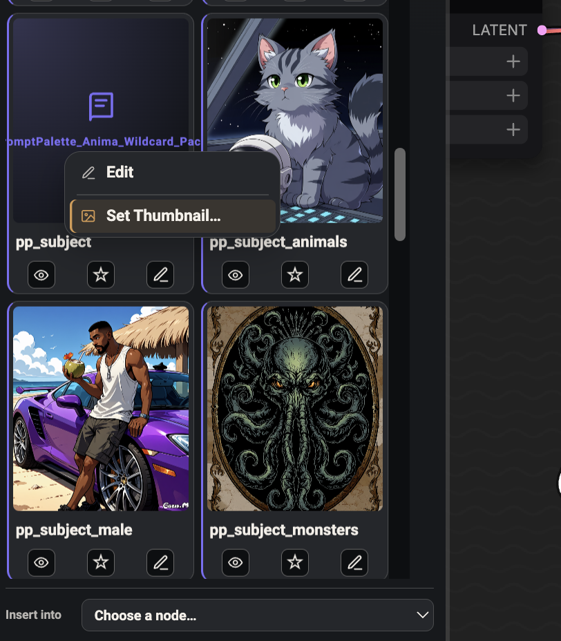</td>
    <td align="center" valign="top">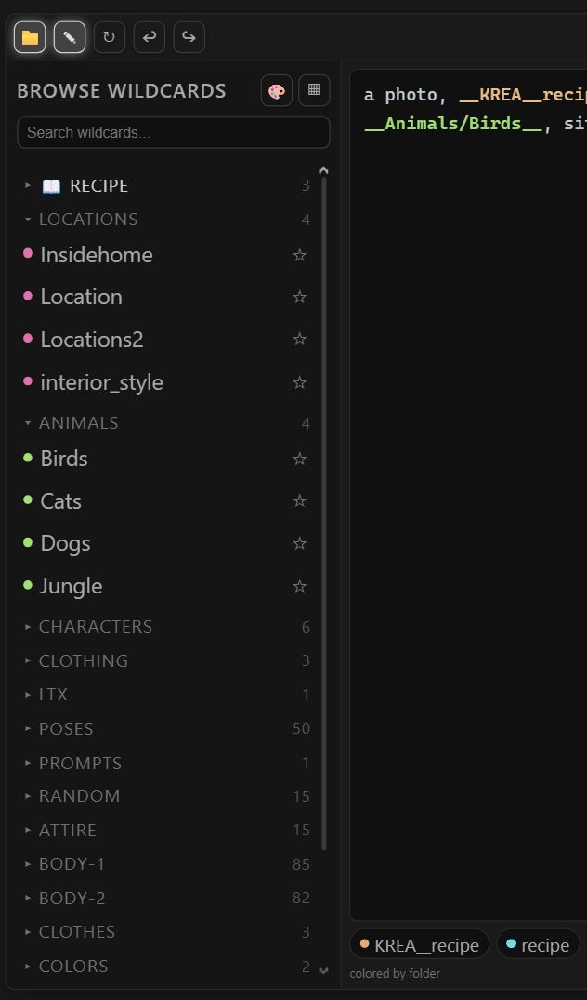</td>
    <td align="center" valign="top">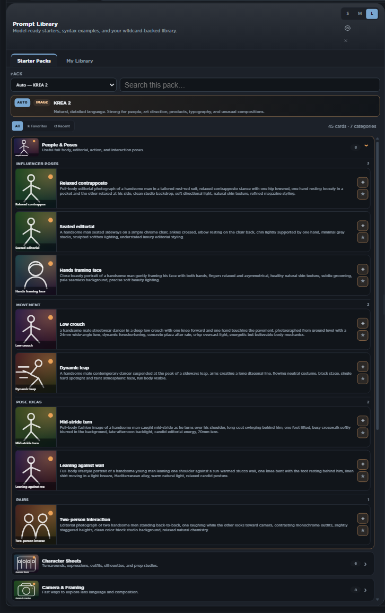</td>
  </tr>
</table>

<details>
<summary><strong>More Library &amp; Stash views</strong> (List view with Favorites/Recent/Recipes and Prompt Stash)</summary>

<table>
  <tr>
    <td width="42%" align="center" valign="top">
      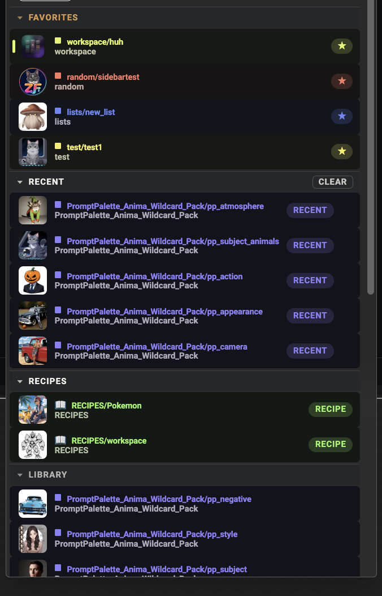<br>
      <sub><strong>List view</strong> · Favorites, Recent, RECIPES, and folder colors</sub>
    </td>
    <td width="58%" align="center" valign="top">
      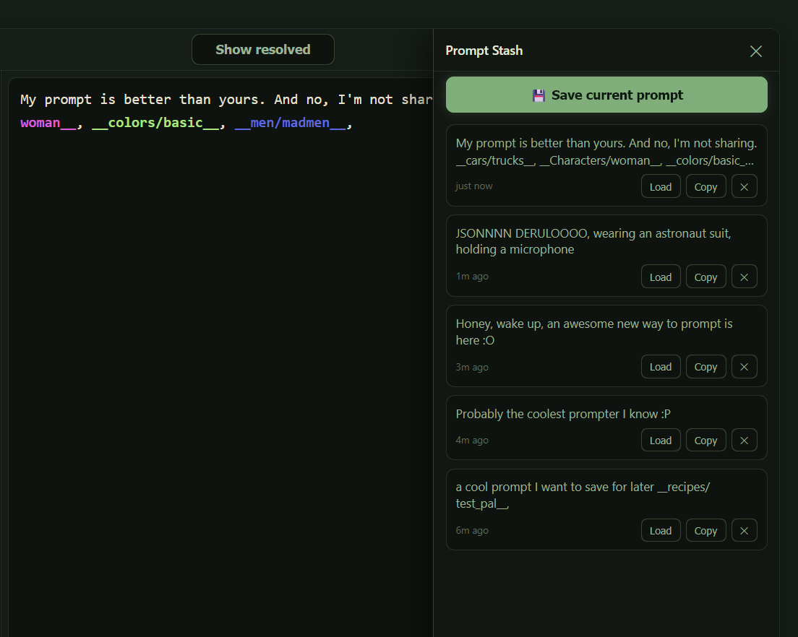<br>
      <sub><strong>Prompt Stash</strong> · save, load, and copy drafts inside the node</sub>
    </td>
  </tr>
</table>

</details>

### Optional Power Tools & Image Import

Every Power Tool stays off until you enable it in **Settings → Power tools**:

- **Prompt Doctor** — Local syntax diagnostics for missing or empty wildcards, unclosed expressions, undefined variables, malformed parameter calls, and duplicate LoRA tags, with **Show in editor** jumps.
- **Variation Lab** — Resolve multiple deterministic previews before queueing, filter duplicates, inspect **One field at a time** trials against a fixed baseline, and **Send to Combinatorial** as an exact batch (matching positive and negative pairs).
- **Resolved Diff** — Side-by-side highlight of what changed between your template and the resolved prompt.
- **Library Manager, Collections & Relationships** — Multi-select management, saved virtual filter collections, dependency inspection, and opt-in relationship rules that constrain participating wildcard picks.
- **Positive Antonyms** — Optional descriptor inversion on the resolved positive prompt while leaving authored text and negatives untouched.
- **Import Prompt from Image** — Drop a PNG, JPEG, or WebP (up to **32 MB**) onto Editor or Combinatorial to recover Palette authored/resolved prompts, ComfyUI API graphs, or A1111 metadata before importing.

<table>
  <tr>
    <td width="43%" align="center" valign="top">
      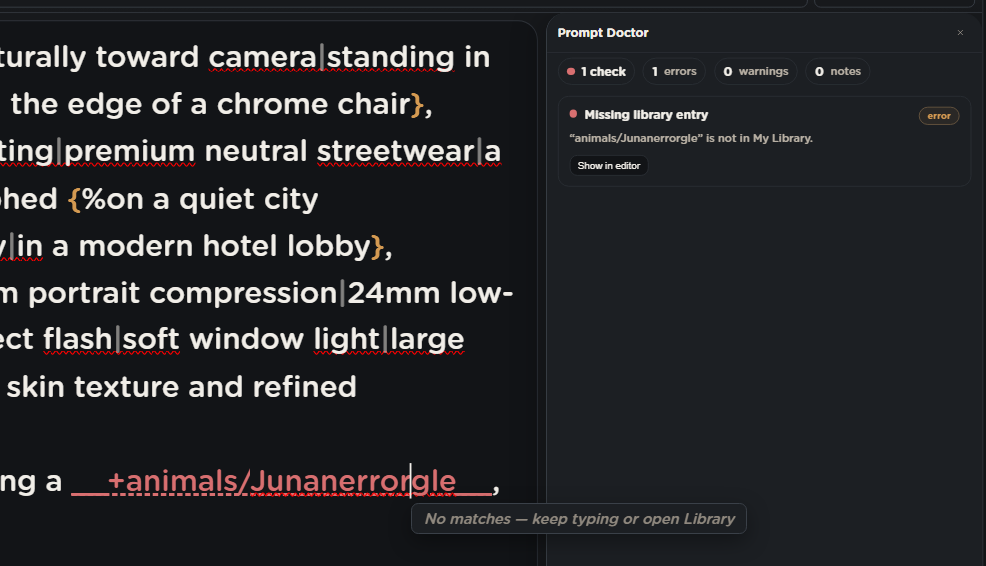<br>
      <sub><strong>Prompt Doctor</strong> · catch missing wildcards and syntax typos before queueing</sub>
    </td>
    <td width="57%" align="center" valign="top">
      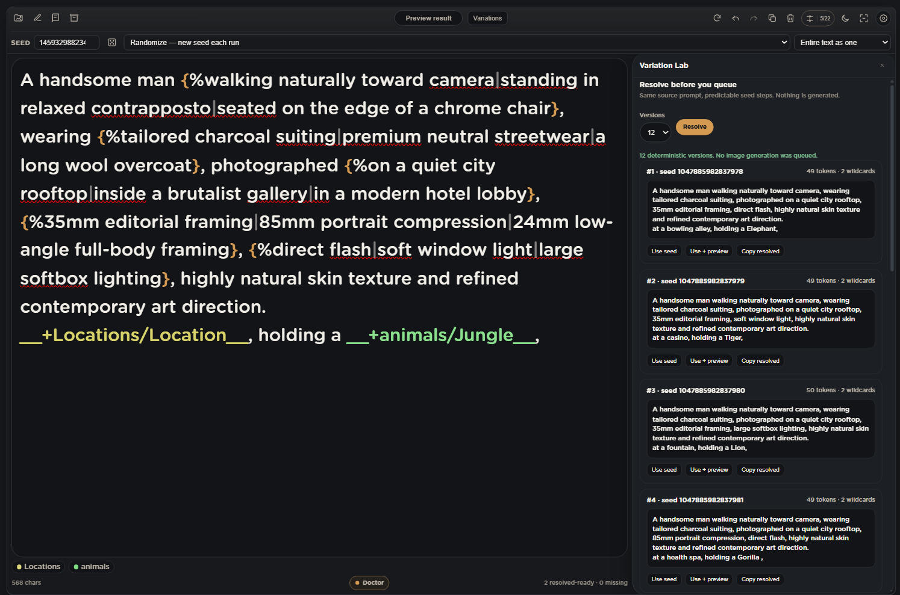<br>
      <sub><strong>Variation Lab</strong> · preview deterministic seeds or isolate one field at a time</sub>
    </td>
  </tr>
</table>

### Optional encoder and workflow sockets

Leave every extra socket closed when you only need resolved text, or enable what your workflow uses in **Ports**:

- **Optional inputs:** `clip`, `model`, `prompt_prefix`, `prompt_suffix`, `enhancer_override`, `external_seed`, `negative_text`, `negative_prefix`, `negative_suffix`, `variables_in`, and per-field `In: <Field>`.
- **Optional outputs:** Patched `model` & `clip`, positive & negative `conditioning`, resolved `prompt` & `negative_prompt`, `seed_used`, `wildcards_used`, `wildcards_count`, `raw_text`, `used_enhancer`, `clip_token_count`, `prompt_metadata`, `variables`, and per-field `Out: <Field>`.

> [!NOTE]
> LoRA tags are applied only when both **Model** and **CLIP** are connected (unless **LoRA execution** is set to **External** or **Strip**). With only **CLIP** connected, recognized tags are stripped before encoding. Tags are scanned **after** wildcard resolution, so wildcards and choices can emit `<lora:name:weight>` dynamically.

<p align="center"></p>

<a id="lorapal"></a>
## LoraPal — Local LoRAs, Model Info & Audition Lab

Browse your local LoRA collection from the **LoraPal** toolbar button (a moveable, resizable floating sidecar with **Follow node** tracking) or from the **LoRAs** tab in ComfyUI's main sidebar. Everything stays **100% local**—LoraPal reads `.civitai.info`, `.metadata.json`, `.rgthree-info.json`, `.txt`, embedded safetensors metadata, and adjacent image/video previews (`.png`, `.jpg`, `.webp`, `.gif`, `.avif`, `.bmp`, `.mp4`, `.webm`, `.m4v`) without fetching anything online.

<p align="center">
  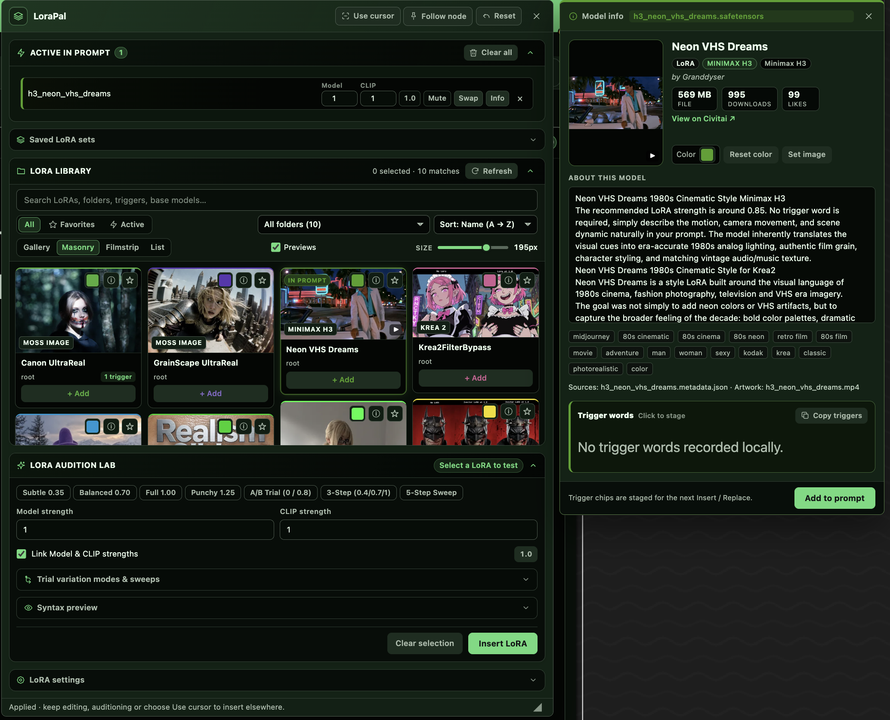
</p>

- **Pop-out Model Info flyout:** Click any card or **ⓘ** to inspect artwork (and step through multiple local images/videos), base model/version pills, author byline, file size, description, tags, suggested strength, **Copy triggers** / clickable trigger chips, per-LoRA **Color** swatches, and **Set image** custom artwork (up to 8 MB, stored per-user without touching model folders).
- **Active in Prompt & `# --- LoRAs ---` docking:** Newly added LoRAs start at strength **1.0** with quick **1.0** resets, independent **Model / CLIP** strengths, non-destructive **Mute**, **Swap**, **Saved LoRA sets**, and automatic trailing `# --- LoRAs ---` prompt docking that keeps inline choices and rules intact.
- **LoRA Audition Lab:** Compare strengths and alternatives with one-click presets (**Subtle 0.35**, **Balanced 0.70**, **Full 1.00**, **Punchy 1.25**, **A/B Trial**, **3-Step**, **5-Step Sweep**) and variation modes (`Cycle`, `Seeded trial`, `Combinatorial batch`).
- **Four virtualized views:** Switch freely between **Gallery**, **Masonry**, **Filmstrip**, and **List** with **80–240px** card scaling and shorthand `<lora:name>` (`1.0`) support. See the [LoRA guide](LORA_GUIDE.md) for full wiring and execution details.

<p align="center"></p>

<a id="keep-and-evolve"></a>
## Keep & Evolve — Recent Generations & Comparison

Enable local run history under **Library → Recent Generations** or open the dedicated **Generations** sidebar tab (**Tab ↗** or **Sidebar settings → Recent Generations tab**). Existing ComfyUI outputs can also be pulled in via **Import ComfyUI history**.

<table>
  <tr>
    <td width="46%" align="center" valign="top">
      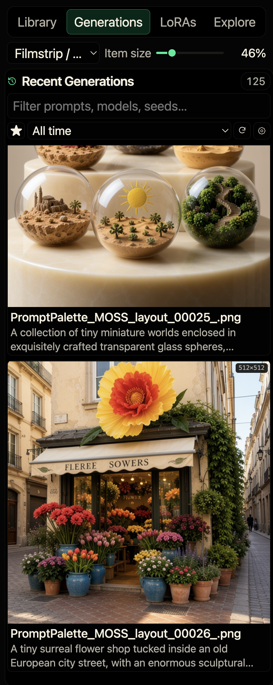<br>
      <sub><strong>Generations tab</strong> · Gallery, Masonry, Filmstrip, and List views</sub>
    </td>
    <td width="54%" align="center" valign="top">
      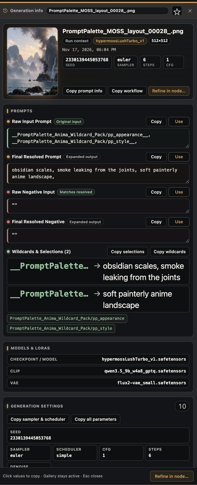<br>
      <sub><strong>Generation Inspector</strong> · Raw vs Resolved prompts, wildcards, LoRAs, and workflow copy</sub>
    </td>
  </tr>
</table>

- **Generation Inspector:** Click any card to open a non-obstructing right-hand flyout with full-size image inspection, **Raw Input** vs **Final Resolved** prompt blocks, exact wildcard & choice selections, color-matched LoRA cards, click-to-copy **Generation Settings** tiles, and a collapsible **Workflow & Nodes** filter (**All / Prompting / Sampling / Models**) for copying one node, a subset, or the full workflow. Navigate with `Arrow` keys, `Home`, `End`, and `Esc`.
- **Keep & Evolve & A/B Wipe:** Pin any generation as a node's **Keeper** reference without touching your active text. Queue up to **4** candidates into **Compare**, inspect **Prompt differences**, slide an interactive **A/B wipe** divider (`Arrow` keys + **Center**), or **Export JSON**.
- **Promote… & Refine:** Review recorded prompts or full authored **Fields** before promoting them into your active editor or any **A–D** draft (with overwrite diff review), or click **Refine** to iterate in-node with **Commit / Cancel** protection.

<p align="center"></p>

<a id="booru-autocomplete"></a>
## Autocomplete — Wildcards, Booru, Anima & Styles

Prompt Palette's autocomplete adapts to what you type—with optional thumbnails, hover previews, category colors, custom words, and `Ctrl/Cmd+Enter` pass-through so you can queue ComfyUI even while the menu is open.

<table>
  <tr>
    <td width="33%" align="center" valign="top">
      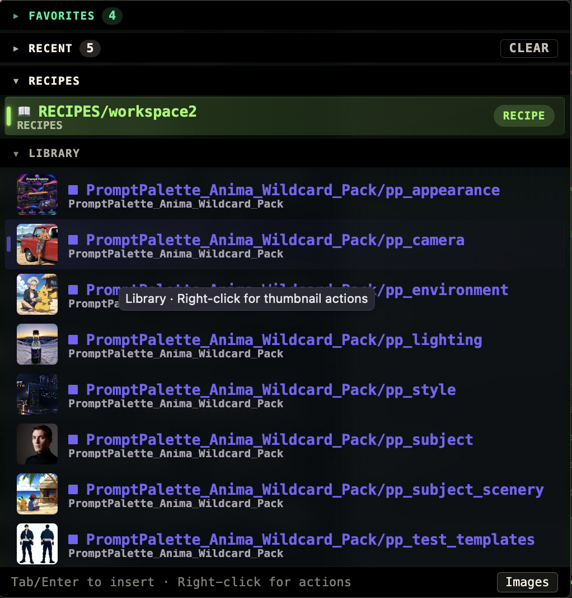<br>
      <sub><strong>Wildcard library (<code>__</code>)</strong> · Favorites, Recent, RECIPES, and thumbnails</sub>
    </td>
    <td width="34%" align="center" valign="top">
      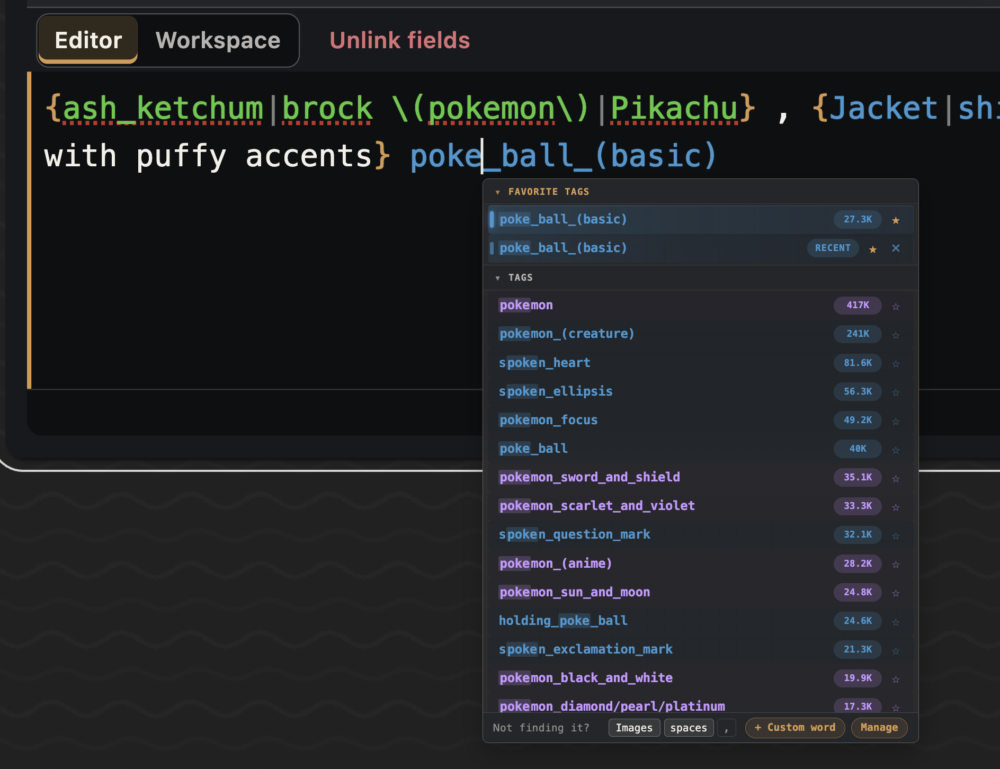<br>
      <sub><strong>Booru &amp; custom words</strong> · category colors, counts, and inline coloring</sub>
    </td>
    <td width="33%" align="center" valign="top">
      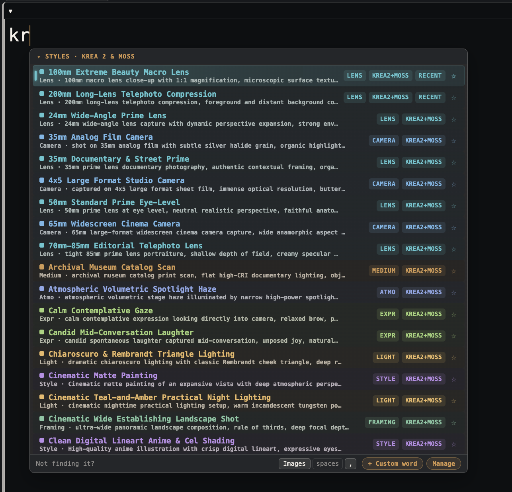<br>
      <sub><strong>Style autocomplete (opt-in)</strong> · Krea 2 &amp; MOSS facet badges</sub>
    </td>
  </tr>
</table>

- **Wildcard (`__`) & LoRA (`<lora:`) suggestions:** Type `__` to search your local wildcard folders with optional thumbnail previews, Favorites, Recent, and RECIPES. Toggle **Images** directly in the menu footer.
- **Offline Booru & Custom Words:** Enable under **Settings → Editor & suggestions** (**Off**, **Auto**, or **On demand** via `Ctrl+Space`). Filter by `artist:`, `character:`, `series:`, `general:`, or `meta:` (aliases `art:`, `char:`, `copy:`, `gen:`), toggle **underscores → spaces** and **append comma**, mark already-present tags with `✓`, or click **+ Custom word** / **Manage** / **Save as list** (saved locally in `prompt_palette/autocomplete.txt`).
- **Anima `@artist` search:** Type `@` followed by a name to search the bundled **Anima artist snapshot** (`59k+` names) and insert `@artist name` (distinct from sequential `__@wildcard__`).
- **Opt-in Style autocomplete:** When enabled in Settings, prefix queries with `style:`, `cam:`, `lens:`, `angle:`, `framing:`, `pose:`, `expr:`, `light:`, `atmo:`, `comp:`, `krea2:`, or `moss:` to insert curated Krea 2 & MOSS phrases verbatim without Booru underscore/parenthesis transforms.

<p align="center"></p>

<a id="main-sidebar"></a>
## Main Sidebar & Opt-in Style Studio

Open **Prompt Palette** in ComfyUI's main sidebar to browse, edit, and insert across your graph. **Insert into** tracks the active Prompt Palette node automatically (or lets you pin a target), while browsing and library editing work even without a selected node.

| Tab | What you can do |
|---|---|
| **Library** | Search folders, pinned entries, recents, and **Recent Generations**; preview entries, insert wildcards, or edit with the pencil. |
| **Generations** *(optional)* | Dedicated run-history tab with **Gallery, List, Masonry, and Filmstrip** views, search/date filters, **Import ComfyUI history**, and the **Generation Inspector**. |
| **LoRAs** | Browse your local LoRA catalog, inspect the **Model info** flyout, manage **Saved LoRA sets**, audition strengths, and insert via **Insert into** or **Use cursor / selection**. |
| **Explore** | Browse **59k+ Anima artists**, classic artists, Booru tags, and **193 bundled reference images** (**120** SFW Anima portraits + **73** public-domain/CC0 references, [credits](STYLE_IMAGE_CREDITS.md)); compare up to **4** styles side-by-side. |
| **Syntax** | Interactive **Choose your prompting language** starters (plain language, tags, MOSS captions/layouts, image editing) and visual syntax examples. |
| **Tools** | Quick access to prompting tools supported by the selected node. |

### Edit a library entry

Click any entry's **pencil** to edit its saved lines in a full-featured shared drawer (available in both the node and sidebar) with **Suggest** (`Ctrl+Space`), **Syntax**, **Find**, **Expand**, **Clean up** (sort, deduplicate, trim), **Save / Save copy**, and draft retention (**Back to library / Resume**).

### Opt-in Style Studio (Krea 2 & MOSS-Image)

Enable **Style Studio** in **Settings → Editor & suggestions** to add a floating **Style Studio** sidecar tuned for **Krea 2** natural-language photography/editorial prompts and **MOSS-Image** prompting (**Caption**, **Ordered Tags**, and **Spatial JSON** dialects):

- Browse **94** SFW style, medium, camera, lens, angle, framing, pose, expression, lighting, atmosphere, composition, and syntax entries plus **8** curated mixes across **12 facets**.
- Stage multiple entries into the **Mix & Composer** tray, toggle **Subject-First** vs **Scene-First** word-budget ordering or **`Mix {%a|b}`** variation blocks, format `"Quoted Text"` typography, check **conflict & buzzword lint** + quick token estimates, and add a safe MOSS negative helper.

<p align="center"></p>

<a id="themes"></a>
## Themes & Appearance

Prompt Palette ships with **72 built-in palettes** across **12 collections** (**Soda Shop, Planetarium, Ocean, Garden, Sweet Shop, Pixel Arcade, Trailhead, Night, Daylight, Creative, Professional,** and **Materials**) inside a full-width **Theme Studio**. Every theme applies cleanly across Prompt Palette nodes, the main sidebar, and pop-out flyouts without recoloring the rest of ComfyUI.

<p align="center">
  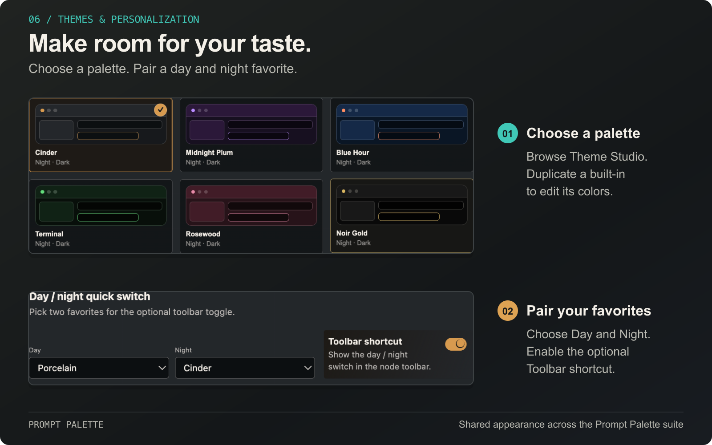
</p>

- **Day / Night quick switch:** Pair any light and dark favorite (such as **Porcelain** and **Cinder**) and toggle right from the toolbar.
- **Custom themes & category colors:** Duplicate any built-in palette to edit all 12 tokens, import/export JSON themes, tune wildcard hue/saturation, and customize per-folder or per-LoRA colors.
- **Typography, toolbar & status bar:** Pick **Core / Creator / Power User** workspace presets, adjust **Prompt text**, **Interface text**, and **Menus & hover cards (80–250%)** independently, scale/reorder toolbar buttons (**60–180%**, **Always visible / Auto hide / Collapsed / Hidden**), and choose **Auto hide / Always visible / Warnings only** for the bottom status bar.

<p align="center"></p>

<a id="combinatorial"></a>
<p align="center">
  
</p>

The **Combinatorial** node turns one wildcard-aware template into a **list of resolved prompts in a single execution**. It shares Prompt Palette's editor, Fields workspace, LoraPal, theming, and syntax tools while outputting lists so downstream ComfyUI nodes can fan out across the entire batch.

<p align="center">
  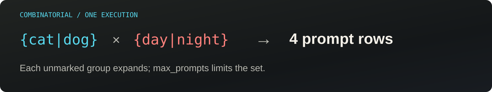
</p>

<p align="center">
  
</p>

| Mode | What it does | Use it when |
|---|---|---|
| **Random** | Resolves the template `count` times with independently derived seeds (sampling with replacement). | You want a fixed number of variations without expanding the full matrix. |
| **Combinatorial** | Expands every **unmarked** `__wildcard__` and `{a\|b}` group into the full Cartesian product, stopping at `max_prompts` (`0` = built-in limit of **5,000**). | You want every subject × outfit × lighting combination or a complete test matrix. |

- **Opting out of expansion:** Any group carrying an explicit sampler marker (`+`, `-`, `*`, `~`, `@`, or `%`) makes one pick per generated prompt instead of expanding combinatorially—ideal for keeping background details varied while systematically sweeping core attributes.
- **Controls & live estimate:** Configure `count`, `seed`, `seed_mode` (**Sequential**, **Fixed**, or **Random**), and `max_prompts` while **Estimated output** warns before hitting the cap.
- **List outputs vs. single-value outputs:** Connect **List outputs** (`Model list`, `CLIP list`, `Conditioning list`, `Prompt list`, `Seed list`, `Wildcards used`, `Prompt metadata (JSON) list`, `Negative prompt list`, `Negative conditioning list`, and per-field `Out: <Field>` lists) to fan out downstream, or read **Single-value outputs** (`Conditioning (first)`, `Prompt (first)`, `Batch metadata (JSON)`, `Prompt count`, etc.) once per queue.
- **Per-row LoRAs:** With both **Model** and **CLIP** connected, each generated prompt applies its own LoRA stack before encoding.

> [!WARNING]
> In ComfyUI, list outputs cause connected downstream nodes to execute once per item. Check **Estimated output** and set `max_prompts` deliberately before queueing large sweeps.

<p align="center"></p>

<a id="weight-controller"></a>
<p align="center">
  
</p>

The **Weight Controller** is a standalone backend-aware routing companion. Feed it Prompt Palette's resolved `prompt`, `negative_prompt`, `raw_text`, or any `STRING`; it parses explicit `(phrase:weight)` groups and outputs the exact syntax expected by your encoder.

<p align="center">
  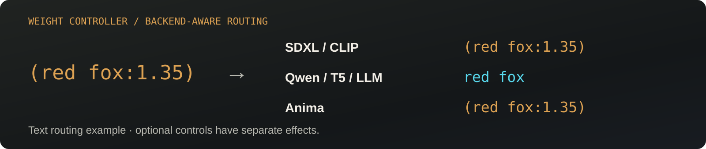
</p>

<p align="center">
  
</p>

```text
a portrait of a (red fox:1.35), dusk lighting, (blurry:-0.8)
```

| Mode | `text` output | Typical route |
|---|---|---|
| **SDXL / CLIP (Standard)** | Keeps `(phrase:weight)` intact | Standard ComfyUI CLIP tokenization; connect `CLIP` for direct conditioning |
| **Krea 2 / ZIT (Qwen)** | Clean de-bracketed prose | Qwen-family encoders; route `negpip_compatible` to a downstream weight/negative patcher if needed |
| **LTX 2.3 / T5 (LLM)** | Clean de-bracketed prose | LLM / T5 / Gemma encoders expecting natural language without literal brackets |
| **Anima 1.0 (High-Scale Qwen)** | Keeps explicit weights up to `3.5` without boosting | Anima / high-scale Qwen pipelines; preserves `@Artist Name`, nested explicit groups, and JSON literals |

- **Outputs:** `text`, `weight_dict` (raw `{phrase: weight}` excluding `1.0`), `negpip_compatible`, `conditioning` (when `CLIP` is connected), `model` / `clip` passthroughs, and `clip_token_count`.
- **Advanced controls (off by default):** **Soft Safety Clamp** compresses extreme weights toward `1.0`, and **Zero Inversion Null** strips negatively weighted phrases in clean-prose modes instead of turning them into ordinary text. `weight_dict` always preserves your authored numbers.

<p align="center"></p>

<a id="wildcard-syntax"></a>
<p align="center">
  
</p>

### Everyday syntax

| Syntax | Meaning |
|---|---|
| `__name__` | Seeded random line from a wildcard file |
| `__*name__` / `__~name__` | Unseeded random line; may change every run |
| `__+name__` / `__-name__` | Sequential forward / backward |
| `__@name__` | Cyclical/sequential-forward alias (Dynamic Prompts syntax) |
| `__%name__` | Joint combinatorial step across every `%` group per Prompt Palette resolve call |
| `{a\|b\|c}` | Seeded inline choice (`*`/`~` unseeded, `+`/`-` sequential, `@` cyclical, `%` joint step) |
| `{2::common\|1::rare}` | Weighted random choice |
| `{2$$, $$a\|b\|c}` | Pick exactly two items and join with `, ` (`{1-3$$, $$...}` for a range) |
| `<lora:name:0.8>` | Load/apply a LoRA when **Model** and **CLIP** are connected (`<lora:name>` defaults to `1.0`) |

<details>
<summary><strong>Advanced templates, globs, variables, and conditionals</strong></summary>

| Syntax | Meaning |
|---|---|
| `__colours*__` | Pool entries from wildcard names matching a glob pattern |
| `__artists/**__` | Recursive wildcard glob below a folder |
| `__template(subject=fox)__` | Parameterized multi-line template wildcard |
| `${name=value}` / `${name=!value}` | Assign a lazy variable / resolve-immediately variable |
| `${name}` / `${name:default}` | Read a variable (with optional fallback) |
| `{3#__name__}` | Expand the wildcard token three times before multi-select processing |
| `[if expr] ... [elif expr] ... [else] ... [/if]` | Conditional prompt blocks supporting `==`, `!=`, `>`, `>=`, `<`, `<=`, `in`, `and`, `or`, `not` |
| `[switch name][case "val"]text[default]fallback[/switch]` | Multi-branch switch on a Prompt Palette variable |

Nesting resolves innermost-first. Lines starting with `#` are treated as comments and omitted at resolution time. Complete valid JSON objects—such as **MOSS-Image** spatial layout guidance (see [MOSS_PROMPTING.md](MOSS_PROMPTING.md))—remain literal through resolution and batches while choices and wildcards outside JSON resolve normally.

> **Note:** In the standard **Prompt Palette** node, `%` syntax advances **one joint combination per execution**. In **Combinatorial**, unmarked groups expand into the full set in one execution without requiring `%`.

</details>

<p align="center"></p>

<p align="center">
  
</p>

### Keyboard & mouse shortcuts

| Shortcut | Action |
|---|---|
| `Ctrl/Cmd + Z` / `Ctrl/Cmd + Shift + Z` (or `Y`) | Undo / Redo |
| `Ctrl/Cmd + F` / `Ctrl + H` (`Cmd + Option + F`) | Open Find / Replace with preview in the main prompt |
| `Alt/Option + 1–4` (`+ Shift` to copy) | Switch to (or copy current draft into) quick draft **A–D** |
| `Shift + Click` on toolbar **Seed** pill | Open **Wheel of Fortune** directly |
| `Ctrl + Space` | Open autocomplete in **On demand** mode or inside a library editor |
| `Ctrl/Cmd + S` / `Ctrl/Cmd + F` in Edit drawer | Save wildcard file / Find within entry |
| `Arrow keys` / `Home` / `End` in **Generation Inspector** | Step between generation cards or adjust the **A/B wipe** divider |
| `Esc` | Close the topmost active flyout, inspector, drawer, menu, or popup |
| `Ctrl/Cmd + Enter` | Pass ComfyUI's run shortcut through while editing |
| Right-click / `Alt/Option` + right-click prompt text | Prompt Palette actions / native spelling & OS edit tools |
| Right-click / Double-click a `__wildcard__` | Open Syntax Injector for that token / open in the Edit drawer |

<a id="troubleshooting"></a>
### Troubleshooting & Compatibility

<details>
<summary><strong>The node loads, but its custom UI does not appear</strong></summary>

1. Update ComfyUI and its frontend.
2. Restart ComfyUI completely and hard-refresh the browser (`Ctrl/Cmd + Shift + R`).
3. Confirm the repository folder is named `comfyui-promptpalette` and contains the `web/` directory.
4. Check the browser console for messages starting with `[PromptPalette]` or `Prompt Palette:`.
</details>

<details>
<summary><strong>My wildcard stays unresolved</strong></summary>

- Confirm the file exists inside the active wildcard library path and use slash paths without the extension (`characters/monsters.txt` → `__characters/monsters__`).
- Click **Refresh** in the wildcard browser after adding files externally. Bare leaf names resolve only when unambiguous across folders.
</details>

<details>
<summary><strong>Combinatorial mode creates too many runs</strong></summary>

Check **Estimated output** before queueing. Reduce wildcard sizes, mark groups that should make only one pick (`+`, `-`, `*`, `~`, `@`, `%`), or lower `max_prompts`.
</details>

<details>
<summary><strong>Weights appear as literal text</strong></summary>

Confirm the Weight Controller mode matches your text encoder. Standard ComfyUI CLIP parses explicit `(phrase:weight)` syntax; Qwen/LLM-style encoders need clean prose plus a compatible downstream weighting patcher.
</details>

- **Supported environments:** ComfyUI **Nodes 1.x and 2.x**, ComfyUI Desktop and portable installations, `.txt` / `.yaml` / `.yml` wildcard libraries, and large nested directories with cached background scanning. All browsing, autocomplete, LoRA metadata, and history tools operate **100% locally**.

### Credits

Prompt Palette builds on conventions and inspiration from:

- **ComfyUI and the ComfyUI community** — the node-based creative ecosystem.
- **Adi Eyal / Dynamic Prompts** — wildcard and dynamic-prompt syntax conventions.
- **Jtkelm2 and AUTOMATIC1111 contributors** — early text-file prompt replacement workflows.

Built by **z3rofeels**.

<p align="center">
  <a href="https://z3rofeels.github.io/comfyui-promptpalette/">Website &amp; Live Studio</a> ·
  <a href="https://github.com/z3rofeels/comfyui-promptpalette/issues">Report a bug</a> ·
  <a href="https://github.com/z3rofeels/comfyui-promptpalette/discussions">Start a discussion</a> ·
  <a href="https://github.com/z3rofeels/comfyui-promptpalette">Star Prompt Palette</a>
</p>
